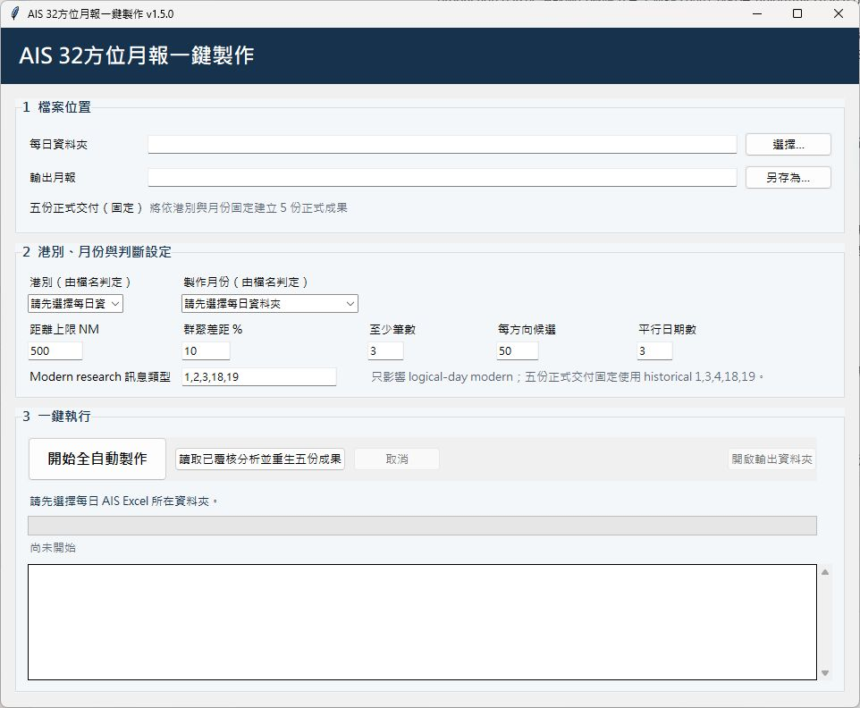

# AIS 32 方位月報一鍵製作

[](https://github.com/tomoya034/ais-32-direction-monthly-report/actions/workflows/tests.yml)
[](https://github.com/tomoya034/ais-32-direction-monthly-report/releases/tag/v1.5.6)
[](LICENSE)

離線讀取 `D&TMOK <PORT>_YYYYMMDD_*.xlsx`（亦相容既有個位日期 `YYYYMMd`），把同港別、同日期的任意數量檔案視為同一個 logical day，再一次產生 Modern research 分析及五份正式 Historical delivery 工作簿。檔名尾碼只供追溯，不代表固定來源或時段；程式不使用雲端 API，也不會上傳 AIS 資料。

> 正式交付版為 `v1.5.6`：直接採用完整回歸通過的 r2 EXE，未重新 build。已完成 2026 全量雙跑、2024 六個安全月、負向來源測試，以及桌面部署後 HWLN 2026/04、2026/06 實機驗收。AUTO、message profiles、A/B、500 NM 與32方位分箱不變；AUTO 等同人工研究判讀仍未被證明。正式驗證範圍及升級限制見 [`v1.5.6 Release Notes`](docs/RELEASE_V1.5.6.md)；過往 local 版本章節是歷史紀錄，以本版說明為準。

## 1.5.6：Source Preflight 與 CLI hardening

- 正常分析及覆核重生前，先逐列做來源安全預檢；JSON 與人讀摘要各自保存，沒有來源轉換或靜默排除。
- 以欄位名稱及 worksheet 結構辨識 schema，記錄欄序／改名變體。GPS_* 可辨識但不自動 alias；mixed-date、缺欄、未知／重複必要欄位阻擋整月。
- 缺日／不完整月與 partial-day 指標明確警告；來源 cache 只對應來源日，完整日曆的缺日保持空白。
- 完整重複、normalized core overlap／subset 先阻擋。`SUBSET_CANDIDATE` 不是自動排除授權；須保留來源 SHA、包含證據及排除 manifest，另建安全輸入 view。
- CLI 失敗回傳非零、持久保存 `AIS32_CLI_FAILURE_*.json` 並嘗試寫 stderr，不再把 SourceFileError 送到 packaged windowed bootloader 的互動對話框。GUI 仍使用可理解的錯誤訊息及相同錯誤分類。

只盤點來源（不建立 Excel、不改來源），報告資料夾必須是新路徑且在來源外：

```powershell
.\AIS_32方位月報工具.exe --input "D:\AIS資料\2024" --preflight-only --recursive --workers 3 --preflight-report "D:\AIS驗證\2024_preflight_001"
```

報告包含 `SOURCE_PREFLIGHT_REPORT.json` 與 `SOURCE_PREFLIGHT_SUMMARY.md`。SAFE 只認證本次來源快照，不代表數值／研究成果已獲核准；BLOCKED 回傳非零且不進入正式處理。正常分析會自動預檢，不必改變原本操作方式。若原輸出位置在來源資料夾內，新增預檢報告改放獨立暫存位置，避免增加來源 sidecar。

## 1.5.5：輸出安全修復候選

- 開始前檢查 Modern 與五份正式成果的最終／暫存路徑，拒絕相互碰撞或與 AIS 原始來源相撞。
- 以程序鎖保護共用的輸出、cache 和 normalized spool；第二個程序遇到相同資源會明確停止。鎖位於使用者暫存目錄，不寫入原始 AIS 資料夾。
- 首次分析的 Modern 與五份 Historical 先完成整組建置，再一起替換；中途出錯會還原原有六份成果，避免新台帳配舊表格。
- 補強 source/copy verifier 的 checkpoint 身分、錯誤重試、原子儲存及 fresh/resume 計數，並加入不共用 production parser／方位函式的獨立來源稽核。
- 目前修復與全量驗證紀錄見 `docs/FULL_REGRESSION_20261007.md`；未完成項目保留 `UNVERIFIED`。

## 1.5.4：結案後全量回歸修復版

- 接受 `YYYYMMd` 個位日期檔名，修正 HWLN 2026-04-01 至 04-09 被靜默忽略；看似 AIS 原始檔但日期／格式不可解析時改為 fail closed。
- Historical 雷達圖預設改為六月確認成果的 filled radar、30 色 Office palette 與 60% transparency；統計圖回復青色 MAX、橙色 MIN、紅色 2.25 pt AVG line。
- 圖表尺寸、位置、Plot Area、軸線／格線、圖例與標題依六月 reference 契約調整；KLNG 統計圖以正確 hidden helper 重現 `WSW..NbW, N..ESE` 視覺順序，B:AG 資料順序不變，也不沿用 reference 的舊錯位 range。
- 新增全來源盤點、全量執行、reference grid、OOXML、Excel-native 與 deterministic package regression 工具。

## 1.5.3：本機驗證修復版

- Period A/B 大 workbook 的「總表」改為逐列完成 AI:AL helper cells，維持 `constant_memory` 低記憶體模式；五份 Historical Chart 2 都寫入連續 chart cache，helper 缺值仍維持空白。
- Modern、legacy 與 Historical 總表的跨表引用及 MAX/MIN/AVERAGE/STDEV.S 公式加入 COUNT guard；Excel 原生重算後缺值不會被轉成 0。
- Modern、Historical Period A、Historical Period B 與 A/B 整合圖表標題明確標示 scope，避免把不同 profile／period 的圖誤認為同一結果。
- 非 byte-identical fragments 若含 exact normalized core duplicate，或 overlap audit 超過 250,000 筆而無法證明安全，會停止整月且不建立／替換正式檔；不做 silent dedupe。
- Cache version 為 7，強制 cache 6 失效並重掃原始 fragments。Normalized spool version 1 與 review schema `AIS_V15_REVIEW_3` 不變。

## 1.5.2：站點方位與雷達圖

- 方位設定 `auto`：KLNG 保留原 21 方位；HWLN 和其他站點採 `all32`，讓全部 32 方位的有效結果進入總表。這是「不套地理排除」的設定，不是已驗證各站 32 方位全屬海域。
- 可明確指定 `--direction-policy klng21` 或 `--direction-policy all32`。設定會進入快取與覆核身分驗證，不會把舊 21 方位台帳當成已完整覆核的 32 方位結果。
- 雷達圖 `--radar-style auto`：依六月確認成果使用填色。可另選 `line` 或 `filled`。
- 雷達圖刻度預設自動；`--radar-max` 可指定上限，但不得小於要呈現的有效數值。`--max-distance` 是選值距離上限，與雷達圖刻度不同，兩者單位均為 NM。
- 缺乏有效資料仍留白，不補 0。訊息集合、11.25° floor-bin、500 NM 預設選值上限、10%／3 筆群聚、Period A/B 和整合規則未改。
- Cache version 為 6，review schema 為 `AIS_V15_REVIEW_3`。舊覆核工作簿須重新分析及覆核，不能直接套入新設定。

升級及操作詳見 [`docs/HWLN_STATION_FIX.md`](docs/HWLN_STATION_FIX.md)。



## 📥 下載與標準流程

1. Windows 執行版請下載 [GitHub Releases v1.5.6](https://github.com/tomoya034/ais-32-direction-monthly-report/releases/tag/v1.5.6) 的 `AIS_32_Direction_Monthly_Report_v1.5.6.zip`，並核對附上的 `SHA256SUMS.txt`。
2. 解壓縮後雙擊 `AIS_32方位月報工具.exe`，不必安裝 Python。
3. 選擇原始月份資料夾；工具會從檔名辨識港別與年月。
4. 按「開始全自動製作」。第一次執行會產生一份 Modern 分析與五份正式成果。
5. 在 Modern workbook 的「決策台帳」覆核 `logical_day`、`period_a`、`period_b`，然後儲存該 workbook。
6. 回到程式按「讀取已覆核分析並重生五份成果」。程式會驗證來源 manifest 與決策，再由同一份 decision snapshot 以 rollback 保護整組替換五份成果。

不要直接修改五份交付 workbook；再次 finalization 會以已儲存的 Modern decision ledger 為唯一決策來源。

`Source code (zip)` 與 `Source code (tar.gz)` 是 GitHub 自動產生的原始碼封裝，不是一般 Windows 使用者的執行版。Windows 可能因 EXE 尚未做商業程式碼簽章而顯示未知發行者；請只從本專案 Release 下載，並核對 Release 提供的 SHA-256。

## 📄 輸入資料

每日來源檔案需符合：

```text
D&TMOK <PORT>_YYYYMMDD_*.xlsx
D&TMOK <PORT>_YYYYMMd_*.xlsx   # 既有個位日期相容格式
```

例如：

```text
D&TMOK KLNG_20260701_11.xlsx
D&TMOK KLNG_20260701_23.xlsx
D&TMOK HWLN_20260101_part2.xlsx
```

程式會從檔名取得港別與日期。港別代碼採 2–16 位英數字、第一個字元為英文字母，大小寫不敏感並統一轉為大寫；支援範圍沒有寫死為 KLNG 或 HWLN。核心使用欄位包含：

- `msg_type`
- `LONGITUDE_DESC`
- `bearing`
- `distance in nautical miles`

正式 provenance 另需可解析的 timestamp、MMSI 與 channel。若活頁簿第一頁為封面或說明頁，程式會自動尋找含必要欄位的 AIS 資料工作表。

## 📊 六份輸出及其語意

Modern workbook：

- `<PORT>_YYYY年MM月_32方位數值_新版自動分析.xlsx`
  - `logical_day` 使用當日所有 fragments 先合併、再完整搜尋群聚。
  - 內含總表、每日分析、候選 provenance、待複核、決策台帳、來源 manifest 與圖表。

五份正式成果預設置於 `正式交付/<PORT>_YYYYMM/`：

- `<PORT> M月 32方位數值_2.xlsx`：Period A 完整工作簿。
- `<PORT> M月 32方位數值.xlsx`：Period B 完整工作簿。
- `<PORT> M月 32方位數值_2 總表.xlsx`：Period A 小總表。
- `<PORT> M月 32方位數值 總表.xlsx`：Period B 小總表。
- `<PORT>_M月_32方位_每日較大值整合總表.xlsx`：逐格整合總表。

Period 是依每列實際時間切分，與 `_11`、`_23` 或其他尾碼無關：

- Period A：`00:00:00 <= time < 12:00:00`。
- Period B：`12:00:00 <= time < 24:00:00`。

五檔固定維持以下可驗證契約：

- `Period detail MAX = Period final`（依選定的 21／32 方位設定；period final 留白時不保留該方位明細）。
- `Period 小總表 = 對應大 workbook 的總表`。
- `Integrated = MAX(Period A final, Period B final)`。
- 統計與兩張圖一律由本次 grid 重算，不複製舊 workbook 的過期統計值。

Modern logical-day final 與 Historical integrated 是兩種不同語意；因為群聚選值是非線性運算，前者不保證等於後者。

32 方位中文名稱採中文維基百科[〈羅盤方位〉](https://zh.wikipedia.org/zh-tw/羅盤方位)表的「中文名」欄，不採「又名」欄。英文縮寫與 11.25° floor-bin index 不變。`klng21` 為「北至東南偏東、西南偏西至北微西，共 21 方位」；`all32` 不排除任何方位。

目前 cache version 為 7、review schema 為 `AIS_V15_REVIEW_3`；舊 cache 安全失效。cache 7 會強制重掃原始 fragments 並執行 overlap safety gate；v1.5.1 及更舊的覆核 workbook 不相容，請由原始月份資料重新分析及覆核，以避免方向名稱或方位政策錯置；不提供自動 migration。Index-based normalized spool version 維持 1。

## 🧭 兩套 profile 與覆核契約

- Modern research profile 預設訊息類型為 `1, 2, 3, 18, 19`，可在 GUI 或 `--message-types` 修改。
- Historical delivery profile 固定為 `1, 3, 4, 18, 19`；修改 Modern profile 不會改變五份正式成果。
- `logical_day` 可選擇同 scope 的 Candidate ID、留白，或輸入非負有限 numeric override。
- `period_a`／`period_b` 只能選擇同日、同 period、同方位、Historical profile 的真實 Candidate ID，或留白；不得輸入任意數字。
- `top_candidates` 只控制 workbook 顯示筆數。selector 永遠搜尋完整合格資料，不能因顯示數量或是否輸出五檔而改變研究值。

候選保存 timestamp、MMSI、channel、來源 fragment、工作表與來源列號，供人工判斷同船、同秒或跨 fragment 群聚風險。完整規則見 [`docs/ALGORITHM.md`](docs/ALGORITHM.md)。

## 🧩 多 fragment、重複與異常資料

- 同港同日的所有 fragments 都會納入；排序不依賴 mtime、尾碼或檔案列舉順序。
- byte-identical 檔案只處理一次，其他路徑記為 alias。
- time-range overlap、occupied-second overlap、正常同秒不同訊息、possible duplicate event 與 normalized-core 相同紀錄分開報告。
- timestamp 或 occupied second 相同不等於 duplicate；可完整稽核且沒有 exact normalized core duplicate 時仍合併處理，也不會把 possible duplicate event 靜默去重。
- 非 byte-identical fragments 若含 exact normalized core duplicate，或 cross-fragment audit 超過 250,000 筆上限而無法證明安全，整個月份會在正式檔建立／替換前停止。錯誤會列出兩個檔名；請移除重複檔，或另建只含已確認互補 fragments 的安全來源資料夾後重跑。
- 損壞 XLSX、缺少正式 provenance 欄位、列內日期不符檔名 logical day 或 spool checksum 不符會阻擋正式輸出。

程式不建立合併後的巨大來源 Excel。每個 logical day 會建立 profile-neutral normalized spool，保留 East、核心欄位有效的必要資料、`msg_type`、時間與 provenance，也保留超過 500 NM 的列；500 NM 只在 selector／renderer 階段套用。

## 💾 快取、容量與失敗保護

- 每完成一個 logical day 就保存帶來源簽章與 checksum 的結果及 normalized spool；來源 metadata、分析設定或 cache/spool schema 變更時，對應日會安全重算。
- 目前採每個 logical day 串流讀取後，以 bounded worker 數進行記憶體內 compact sorting；此設計沿用 v1.5.1 的六月最高量日驗證結果，尚未加入 external merge。
- 五份成果先全部寫入 `.building.xlsx`，成功後才整組替換；替換失敗會復原原有五檔。
- 每張 Excel 明細最多 `1,048,575` 筆資料列；超限會在發布前停止，絕不截斷。目前不提供 split 模式。
- 失敗時會保留已驗證的每日快取，並在輸出資料夾建立 `AIS月報_錯誤報告_*.txt`。

## ⌨️ 命令列

首次分析並產生全部六份成果：

```powershell
python .\ais_monthly_app.py `
  --input "D:\AIS\2026_06" `
  --output "D:\AIS\KLNG_2026年06月_32方位數值_新版自動分析.xlsx" `
  --delivery-dir "D:\AIS\正式交付\KLNG_202606" `
  --port KLNG --workers 2 --overwrite
```

儲存人工覆核後，重新產生五份正式成果：

```powershell
python .\ais_monthly_app.py `
  --finalize-from "D:\AIS\KLNG_2026年06月_32方位數值_新版自動分析.xlsx" `
  --delivery-dir "D:\AIS\正式交付\KLNG_202606" `
  --overwrite
```

`--max-days N` 只供測試，永遠保留前 N 個完整 logical days；`--max-files` 與 `--legacy-output` 僅保留為 deprecated 相容參數。來源含多港別時必須指定 `--port`；`--year` 與 `--month` 只在同一港別含多月份時成對使用。

## 🧪 從原始碼執行與測試

需求：Windows、Python 3.11 以上。

```powershell
python -m venv .venv
.\.venv\Scripts\Activate.ps1
python -m pip install -r requirements.txt
python .\ais_monthly_app.py
python -m unittest discover -v
```

一般測試只建立去識別化小型 fixtures，不需要真實 AIS。六月 external regression 由本機環境變數提供資料，不會進 Git：

- `AIS_JUNE_INPUT_DIR`
- `AIS_JUNE_GOLDEN_DIR`
- `AIS_JUNE_CONTRACT_GATE_JSON`
- `AIS_JUNE_BASELINE_JSON`
- `AIS_JUNE_BENCHMARK_JSON`

## 🪟 建置 Windows EXE

```powershell
.\scripts\build_windows.ps1
.\scripts\package_release.ps1 -SkipBuild
```

建置結果位於 `dist\AIS_32方位月報工具.exe`；Release ZIP 與 `SHA256SUMS.txt` 也位於 `dist`。

## 🔍 人工複核與已知限制

自動分析用於減少逐日、逐方向的人工篩選與複製工作，但不取代領域人員判斷。32 方位邊界、21 個海向依據、AIS 去重、D&TMOK 上游 bearing/distance、時區與固定基點等研究 UNKNOWN，均未由程式自行推定或修改。

## 🔒 資料保護

本工具完全離線運作，不需要 API Key 或 Token，也不會自動上傳 AIS 資料。

`.gitignore` 排除 Excel、CSV、cache、spool、`.building`、`.rollback`、錯誤報告與建置產物。不要在 Git、Issue、Pull Request 或 Release 附上真實 AIS、含 MMSI 的分析檔或 Golden workbook。

## 📋 版本紀錄

完整版本變更請見 [`CHANGELOG.md`](CHANGELOG.md)。最新正式版本與下載檔請見 [GitHub Releases](https://github.com/tomoya034/ais-32-direction-monthly-report/releases/latest)，發布格式與維護規範請見 [`docs/RELEASE_TEMPLATE.md`](docs/RELEASE_TEMPLATE.md)。

## 📄 License

本專案採用 [MIT License](LICENSE)。
